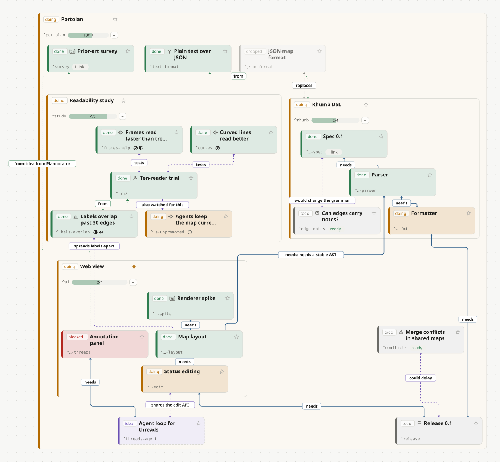

<p align="center">
  
</p>

<h1 align="center">Portolan</h1>

Portolan is a shared map of work for humans and AI agents. It is a mind map that is also a TODO list and a task log, showing the relations, progress and plans across an agent's whole workflow.

**[Live demo](https://k-l-lambda.github.io/portolan/)**: Portolan's own development map in the web view (read-only), with every link opening its entry in the [changelog](docs/changelog.md).

## Why

Agents now do long, branching work: surveys, experiments, refactors that split into sub-tasks and depend on each other. Logs and diaries record what happened, but not the shape of the work. Chat history is linear. It is hard to see what is done, what is blocked and what comes next.

Existing tools cover pieces of this. Agent task trackers keep a task graph, mind-map UIs draw trees, plan-annotation tools let you comment on an agent's plan. None of them gives one shared map that is human-readable, git-friendly, and edited by both the human and the agent.

## Core ideas

- The map holds structure only: work items, status, hierarchy and relations. Details stay in the diary, and the map links into it.
- The map is plain text in the Rhumb DSL (`.rhumb`). It is designed to be easy for LLMs to write: it borrows GFM task lists, YAML and Markdown links, and adds only a small sentence syntax for edges.
- It is designed to diff well in git: one change is one line.
- Annotations live in a sidecar file next to the map, so humans and agents can discuss a node in a thread without cluttering the map.

## The name

A portolan chart was a nautical map drawn from sailors' logbooks, with rhumb lines connecting the ports. It is a map that grows out of logs, which is what this project tries to be. Rhumb is the name of the DSL; its edges are the rhumb lines between work items.

## What a map looks like

[`docs/example.rhumb`](docs/example.rhumb):

```rhumb
---
rhumb: 0.1
title: Portolan
---

- [/] Portolan ^portolan
  - [x] Prior-art survey {kind: survey, estimate: 1d, started: 2026-10-01T09:00Z, finished: 2026-10-02T17:00Z} ^survey
    - Why: reuse what exists; only build the shared map that nothing else provides.
    - Closest pieces: [Backlog.md](https://github.com/MrLesk/Backlog.md), Beads, Plannotator
  - [x] Plain text over JSON {kind: decision, finished: 2026-10-03T12:00Z} ^text-format
    - Why: people and agents both edit the map by hand, and diffs must stay readable.
  - [/] Rhumb DSL {owner: claude} ^rhumb
    - [x] Spec 0.1 {estimate: 2d, started: 2026-10-03T09:00Z, finished: 2026-10-04T18:00Z} ^rhumb-spec
      - [spec](https://github.com/k-l-lambda/portolan/blob/main/docs/rhumb-spec.md)
    - [x] Parser {tags: [peggy, typescript], estimate: 3d, started: 2026-10-05T09:00Z, finished: 2026-10-09T15:00Z} ^rhumb-parser
    - [/] Formatter {estimate: 3d, started: 2026-10-15T00:00Z} ^rhumb-fmt
    - [ ] Can edges carry notes? {kind: question, estimate: 4h} ^edge-notes
  - [/] Web view {star: true} ^ui
    - [x] Renderer spike {kind: spike, estimate: 1d, started: 2026-10-06T09:00Z, finished: 2026-10-06T19:00Z} ^ui-spike
    - [x] Map layout {estimate: 2d, started: 2026-10-10T09:00Z, finished: 2026-10-13T16:00Z} ^ui-layout
    - [/] Status editing {priority: high, estimate: 4d, started: 2026-10-15T18:00Z} ^ui-edit
    - [!] Annotation panel ^ui-threads
      - Blocked: the thread format is not settled
  - [/] Readability study ^study
    - [x] Frames read faster than tree lines {kind: hypothesis, supported: true, replicated: true, finished: 2026-10-08T17:00Z} ^frames-help
    - [x] Curved lines read better {kind: hypothesis, refuted: true, finished: 2026-10-08T17:00Z} ^curves
    - [/] Agents keep the map current unprompted {kind: hypothesis, estimate: 1w, started: 2026-10-08T09:00Z} ^agents-unprompted
    - [x] Ten-reader trial {kind: experiment, estimate: 2d, started: 2026-10-07T09:00Z, finished: 2026-10-08T17:00Z} ^trial
    - [x] Labels overlap past 30 edges {kind: finding, partial: true, contested: true, finished: 2026-10-09T11:00Z} ^labels-overlap
  - [ ] Merge conflicts in shared maps {kind: risk} ^conflicts
  - [ ] Release 0.1 {kind: milestone, due: 2026-11-01, estimate: 2d} ^release
  - [?] Agent loop for threads ^threads-agent
  - [-] JSON map format ^json-format
    - Dropped: hard for people and agents to write by hand

%% relations
rhumb-parser needs rhumb-spec
rhumb-fmt needs rhumb-parser
ui-layout needs rhumb-parser: needs a stable AST
ui-layout needs ui-spike
ui-edit needs ui-layout
threads-agent needs ui-threads
threads-agent relates ui-edit: shares the edit API
rhumb replaces json-format
rhumb from text-format
ui-threads from survey: idea from Plannotator
trial relates frames-help: tests
trial relates curves: tests
labels-overlap from trial
ui-layout relates labels-overlap: spreads labels apart
release needs rhumb-fmt, ui-edit
conflicts relates release: could delay
edge-notes relates rhumb-spec: would change the grammar
trial relates agents-unprompted: also watched for this
```

The same map in the web view:

<p align="center">
  
</p>

Each `- [ ]` item is a node with a status (`[ ]` todo, `[/]` doing, `[x]` done, `[-]` dropped, `[!]` blocked, `[?]` idea) and a stable `^id`. Items without a checkbox are notes. Links are anchors into the diary or elsewhere. `{star: true}` marks a shared favorite; `{kind: hypothesis, refuted: true}` says what an item is and how the evidence for a claim stands; `{estimate: 2h, started: …, finished: …}` times work in progress and records how long it took. Lines like `a needs b` are edges: `needs` and `blocks` set the order of work, `relates` (with a label for domain meaning), `replaces` and `from` record the rest. Progress and readiness are derived by the tools, never stored in the file.

## The time-depth view

<p align="center">
  
</p>

The `3D` button in the toolbar turns time into a level axis running through the map, oldest on the
left and newest on the right. Each card becomes a panel standing at its own moment, its face
orthogonal to the time axis, with the flat layout kept whole inside every moment. The scene is seen
through a perspective camera whose line of sight meets the time axis at about 45°, so panels are
foreshortened and newer ones, nearer the eye, are drawn bigger. Hovering a panel shows its title
flat.

The navigator always draws the flat map, in 3D too, and its frame stays the flat view's camera,
looking square on. The cards inside that frame (the focus nodes) decide the 3D view: their time
span sets the time axis's offset, its length is chosen so the focus nodes' 3D bounding box has the
display's shape, and the scene is placed so that box fills the screen. Panning or zooming, in the
main view or on the navigator, moves that flat camera, and the 3D view follows the cards it now
frames. A single outlier does not stretch the window: it stands in a squeezed tail beyond either
end. Switching views is a camera move: the 3D view starts exactly on the flat view and turns into
place, and leaving it turns back.

Each panel is the card's own DOM carried onto its true perspective shape by a CSS `matrix3d`, so its
text, buttons and click area all lie in the panel's plane. The flow's panes are never transformed,
which is what keeps pan, zoom, the navigator and clicking working exactly as in 2D.

Under each timed card, a bar along the time axis shows the stretch of time that work occupied:

| Under the card | Means |
| --- | --- |
| Solid band in the status colour | A finished run, from `started` to `finished` — what it really took |
| Solid band, green / amber / red | Work in progress, from `started` to now, against its `estimate` |
| Dashed outline | A todo's `estimate`: a plan, not a measurement |

The ruler runs along the floor under the scene and labels the window in hours, days, months or
years; its tick density follows its length on screen. A dashed line drops from each card to the
floor, where a grid line from each tick lets its moment be read.

## Status

Portolan is experimental and changing quickly. What exists today:

- Rhumb 0.1 spec and a Peggy-based parser with tests
- `check` (parse errors, consistency, anchor resolution) and a first `fmt` (assigns missing IDs, normalizes status aliases)
- An edit API (set status, add or delete nodes, rename IDs, add or remove edges) that keeps untouched lines intact
- A thread store for annotations in an append-only `.threads.jsonl` sidecar
- A local server that serves the map, derived values and threads, and pushes file changes live
- A first web view, with a mind map and a diary panel, still being built
- A time-depth view: a 3D toggle that runs time as a level axis through the map, each card a perspective panel standing at its own moment, with the time it occupied as a bar beneath it

The server has no authentication and binds to `127.0.0.1` only. Do not expose it.

Next:

- Annotation UI in the web view
- An agent loop that delivers human comments in threads to the agent and writes replies back
- A fuller formatter

## Install

```sh
npm install -g @k-l-lambda/portolan   # or: npx @k-l-lambda/portolan serve <dir>
portolan serve path/to/maps            # then open http://127.0.0.1:4310
rhumb check path/to/plan.rhumb
```

The package ships the compiled CLI, the library API (`import { parse } from "@k-l-lambda/portolan"`) and the built web app. It needs Node 22.12 or newer.

## Quick start

pnpm is required. `npm install` crashes with npm 10.9 on this dependency set.

```sh
pnpm install
pnpm test
pnpm build:web

node src/cli.ts check docs/demo/portolan.rhumb   # the project's own map
node src/cli.ts serve docs
```

Then open http://127.0.0.1:4310.

## Docs

- [docs/rhumb-spec.md](docs/rhumb-spec.md): the Rhumb 0.1 syntax specification
- [docs/skill.md](docs/skill.md): guide for agents that maintain a Rhumb map
- [docs/demo/](docs/demo): maps shown in the [live demo](https://k-l-lambda.github.io/portolan/); [portolan.rhumb](docs/demo/portolan.rhumb) is the map Portolan itself is developed with
- [docs/changelog.md](docs/changelog.md): how Portolan was built, entry by entry; the project map links into it
- [docs/example.rhumb](docs/example.rhumb): the example above; `pnpm example:svg` redraws [docs/example.svg](docs/example.svg) from it, and `pnpm example:anim` redraws the 2D/3D animation [docs/example-3d.svg](docs/example-3d.svg)
